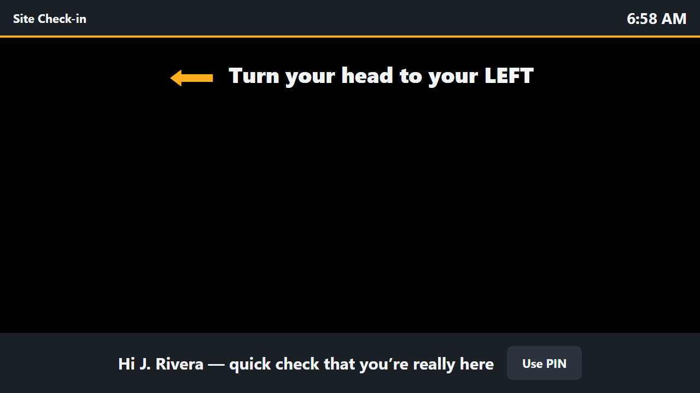
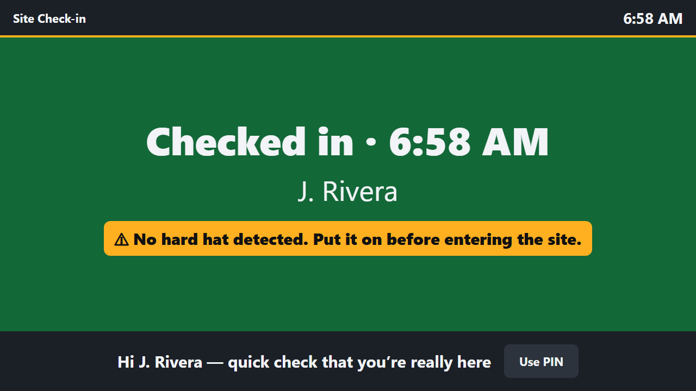
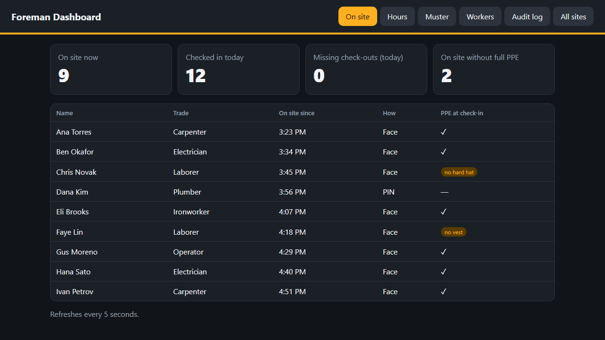
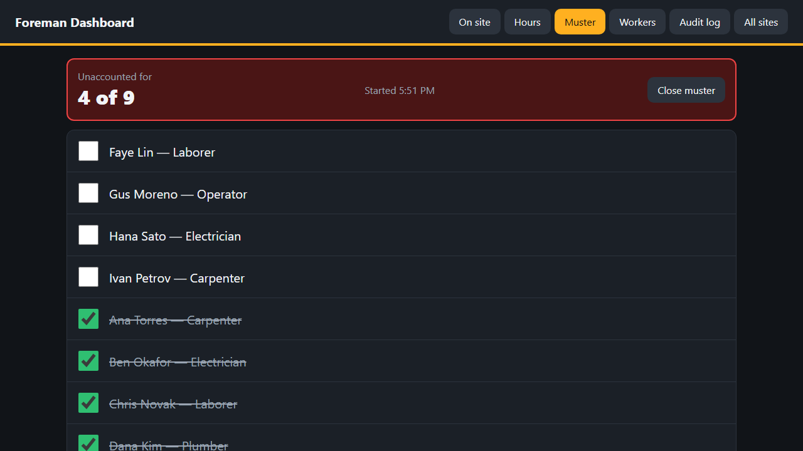
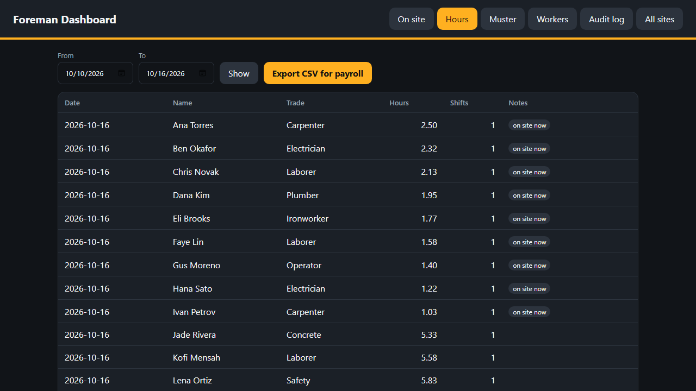
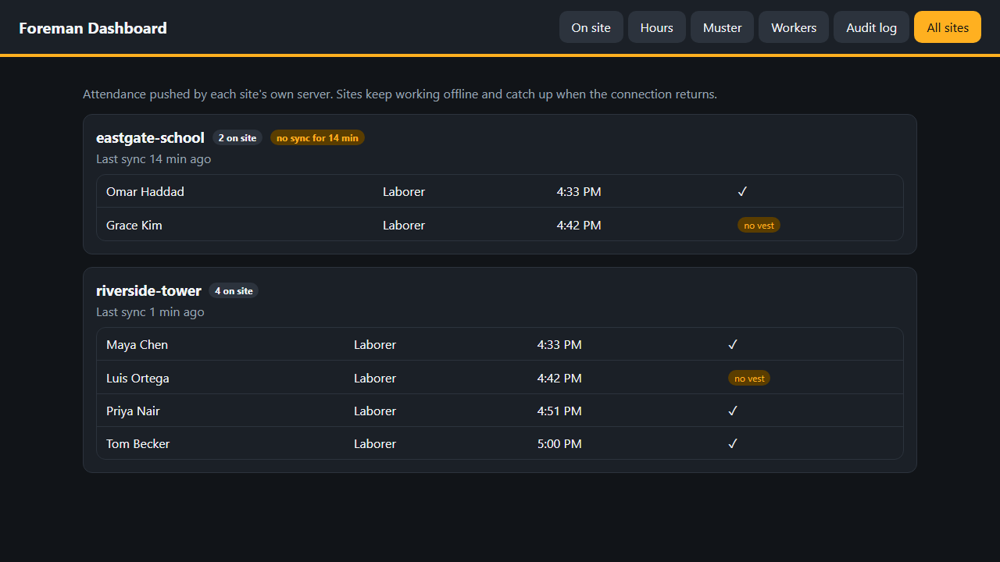

# Jobsite Check-in: face recognition for construction site attendance

Workers check in at the gate with their face. Foremen always know who's on site, payroll gets
accurate hours, and in an emergency the headcount is one click away.

| Kiosk: liveness check | Kiosk: checked in, PPE warning |
|---|---|
|  |  |
| **Dashboard: who's on site, with PPE** | **Emergency muster: one-click headcount** |
|  |  |
| **Weekly hours, CSV export for payroll** | **Every site, synced from the field** |
|  |  |

*Screenshots use made-up workers with no face data.*

## The problem

- **Buddy punching.** On paper sign-in sheets or shared badges, workers clock in for absent
  coworkers, and contractors pay for hours nobody worked.
- **Emergency headcount.** During an evacuation the foreman has to know who is on site.
  A sign-in sheet doesn't tell you who forgot to sign out.
- **Jobsite conditions.** Gloves, dirt, glare and patchy internet. Check-in has to be
  hands-free, and there has to be a fallback when the camera can't see you.

## Two users

| | Uses | Does |
|---|---|---|
| **Worker** | Kiosk at the gate (tablet or laptop + camera) | Walks up, gets recognized, turns their head the way the screen asks (a liveness check), and sees "Checked in · 6:58 AM". If recognition fails, taps **Use PIN** and enters worker number + PIN on a large keypad. |
| **Foreman** | Web dashboard | Sees who's on site now, daily hours with CSV export for payroll, an **emergency muster roster** to tick off at the assembly point, enrolls workers with consent, deletes a worker's data on request. |

## How it works

```
Kiosk (browser)                       FastAPI server                         SQLite
getUserMedia → JPEG every 400 ms ──▶  /api/scan                              workers
                                       MTCNN: detect faces + landmarks         embeddings (3–5 per worker)
                                       take the closest (largest) face         events (in/out, face/pin)
                                       FaceNet: 512-d embedding                musters + entries
                                       cosine similarity vs every stored       audit_log
                                       embedding, best per worker
                                       ≥ threshold → toggle in/out ─────────▶
```

- **Detection:** MTCNN (facenet-pytorch). **Recognition:** InceptionResnetV1 pretrained on VGGFace2.
- **Several embeddings per worker.** Enrollment captures 5 angles (straight, left, right, up, down)
  and stores each one. A worker's score is their *best* matching angle. This is more robust than
  averaging into a single vector.
- **Vectorized matching.** All stored embeddings sit in one matrix, so matching is one matrix
  product plus a per-worker max (`np.maximum.reduceat`).
- **Batched embedding.** All faces in a frame go through FaceNet in one forward pass.
- **Check-in rules.** Each recognized scan flips in ↔ out. Repeat scans within 60 s are ignored.
  A check-in older than 16 h counts as a missed check-out, gets flagged for the foreman, and isn't
  paid automatically.
- **Threshold from data.** The match threshold isn't hand-picked. `benchmarks/lfw_eval.py` sets it
  to the similarity where the false-accept rate on LFW is 0.1%.
- **Liveness: random head turn.** Being recognized isn't enough to check in. Once a worker is
  recognized facing the camera, the kiosk asks them to turn their head LEFT or RIGHT (random), and
  check-in happens only after the server sees that turn. The server measures the turn ("yaw") as
  how far the nose sits from the midpoint between the eyes, in eye-widths, using the 5 landmarks
  MTCNN already returns, so no extra model is needed. Tilting a flat photo squeezes the eyes and
  nose together, so it can't fake a turn. The challenge fails if:
  - the face disappears,
  - the face jumps or changes size (a swapped photo),
  - the turned face stops matching the worker, or matches someone else better,
  - or 6 seconds pass.

  A worker who is already turned when recognized is asked to look straight first. Otherwise a
  static photo of a turned face would pass half the time. Failures are written to the audit log.
  The thresholds come from LFW: on 1,500 faces |yaw| has median 0.10 and 95th percentile 0.29.
  "Facing straight" means ≤ 0.25, and a turn means ≥ 0.35 in the asked direction.
- **PPE check: warn, never block.** A YOLO11n detector, fine-tuned on Ultralytics'
  Construction-PPE dataset (1,416 real jobsite photos), looks for hard hats and hi-vis vests in
  the frontal frame. Detections are matched to the person checking in by position:
  - a helmet counts only if it sits on top of *their* face,
  - a vest counts only if it's on *their* torso,
  - so a coworker's vest in the background or a hat held in the hand doesn't count.
  - If the camera can't see the torso, the vest is recorded as *unknown*, never as missing.

  Missing PPE never stops a check-in, because a missed detection must not strand someone at the
  gate. Instead the kiosk shows "No hard hat detected. Put it on before entering the site.", the
  check-in event stores what was seen, the audit log records it, and the dashboard shows PPE
  for everyone on site.
- **Offline-first.** Each jobsite runs its own server on the kiosk laptop, so check-in, the PIN
  fallback and the emergency muster all work with no internet. A background job pushes attendance
  to a central server whenever it's reachable:
  - It sends only names, trades and check-in events. Face data and PINs never leave the site.
  - It backs off while offline and catches up in batches.
  - Events are confirmed before they're marked as sent, and the central server ignores
    duplicates, so a push cut off mid-way simply retries.
  - Each site has its own token, and the tokens travel only over HTTPS.

  The office dashboard gets an **All sites** view. This was verified with two real servers and with
  Docker Compose: a check-in made while the central server was down queued, then synced when it
  came back.

## Measured results

All numbers come from the scripts in `benchmarks/`, run on an **AMD Ryzen 7 3700X** CPU and,
where shown, an **NVIDIA RTX 2060 SUPER** GPU. Raw output is in `benchmarks/results/`.

**Verification accuracy: LFW, standard 10-fold protocol, 6,000 pairs**

| Metric | Result |
|---|---|
| Accuracy (10-fold) | **99.43% ± 0.37%** |
| ROC AUC | 0.9995 |
| True-accept rate at 0.1% false-accept rate | **98.9%** (threshold 0.446, used by the app) |
| True-accept rate at 1% false-accept rate | 99.4% (threshold 0.392) |
| Images where MTCNN found no face | 1 of 7,701 |

The 0.1% figure comes from 3,000 impostor pairs, so it rests on very few false accepts. Treat it
as an order of magnitude, not a guarantee. On a real site the risk of matching the wrong person
also grows with the number of enrolled workers.

**Speed: 640×480 frames**

| Step | CPU | GPU |
|---|---|---|
| Face detection (MTCNN) | 23.6 ms | 24.8 ms |
| Embedding 4 faces: one at a time → batched in one pass | 180.6 → **86.2 ms** | 71.9 → **20.9 ms** |
| Matching against 500 workers × 5 angles: Python loop → vectorized | 3.15 → **0.17 ms** | (CPU work) |
| Full pipeline, 1 face, models on every frame | 68.5 ms, **14.6 FPS** | 43.8 ms, **22.8 FPS** |
| Desktop demo, models on every 3rd frame (calculated, model-bound) | ~44 FPS | ~68 FPS |
| Kiosk `/api/scan` over HTTP to a local server (decode + pipeline + DB write) | **68 ms** | **45 ms** |

Batching makes embedding 2.1× faster on the CPU and 3.4× on the GPU, and vectorizing makes matching about 19× faster. MTCNN
doesn't speed up on the GPU, because its small cascaded networks are dominated by
per-call overhead. An early GPU measurement of `/api/scan` read 110 ms. That turned out to be
the test client starting a fresh thread per request, which re-creates CUDA handles each time.
Against a real server it's 45 ms.

**Liveness: does a turned head still match?** (`benchmarks/liveness_eval.py`, LFW)

| Metric | Result |
|---|---|
| Turned faces (yaw ≥ 0.35) still matching 3 frontal photos of the same person | **124 / 124**, at both the liveness threshold (0.392) and the strict check-in threshold (0.446) |
| Photos that read as facing straight (\|yaw\| ≤ 0.25) | 92% of 6,733. The rest would first be asked to look straight |

124 is a small sample. Zero failures in 124 means the true pass rate is very likely at least
97.6% (rule of three), not that it is 100%.

**Hard hats: synthetic proxy** (`benchmarks/hardhat_eval.py synthetic`)

These numbers come from LFW's 6,000 pairs with a hard hat *drawn on* each face: a dome, a brim
at mid-forehead, and a shadow under the brim, placed from the face's landmarks. That makes them
a proxy, not field data. A drawn hat misses real shadows, how a hat sits on the head, and how
people hold their heads under one. All figures are at the threshold the kiosk uses (0.446).

| | No hat | Enrolled without, check in with hat | Hat in both photos |
|---|---|---|---|
| Genuine check-ins accepted | 98.9% | **97.0%** | 98.5% |
| False accepts (of 3,000 impostor pairs) | 3 | 4 | **20** |
| 10-fold accuracy | 99.43% | 98.90% | 98.72% |

| | No hat | Hat |
|---|---|---|
| Face detected | 99.99% | 99.97% |
| Reads as facing straight (needed for liveness) | 91.9% | 91.9% |

What this means for the product:

- **Enroll without the hat.** With a hat in both photos, false accepts rose about 7×: the shared
  hat makes different people look alike. The enrollment screen now asks the worker to take
  their hard hat off.
- **Checking in with a hat works, with more retries.** Rejections roughly triple (1.1% → 3.0%),
  so roughly 1 in 33 attempts needs a second look or the PIN.
- **Real numbers come next.** `scripts/capture_hardhat.py` records consenting people with and
  without a real hat, saving embeddings only, and `benchmarks/hardhat_eval.py real` scores them
  the way the kiosk does.

**PPE detector** (`scripts/train_ppe.py`), measured on Construction-PPE's **test split**: 141
real jobsite photos never used in training. 40 epochs took 7 minutes on an RTX 2060 SUPER
(about 6 minutes *per epoch* on the CPU).

| Class | Precision | Recall | mAP50 |
|---|---|---|---|
| helmet | 0.889 | **0.901** | 0.933 |
| vest | 0.772 | **0.876** | 0.906 |
| Person | 0.775 | 0.834 | 0.848 |
| no_helmet | 0.385 | 0.225 | 0.206 |

| Inference, 480×360 kiosk frame | CPU (Ryzen 7 3700X) | GPU (RTX 2060 SUPER) |
|---|---|---|
| PPE detector | 61 ms | 15.6 ms |

- The check finds about 9 in 10 hard hats and vests.
- The "no_helmet" class is weak, with only 40 examples in the test set. The kiosk doesn't depend
  on it: no helmet found on the head already means "no hard hat".
- These photos are general jobsite scenes, not close-ups at a check-in kiosk, so accuracy at
  the gate still has to be measured on real kiosk frames.

The kiosk sends a frame every 400 ms. From a face entering the frame to the confirmation
screen is about one scan interval plus 45–70 ms of server time, plus the head turn (about 1–2 s), plus network latency when
the server isn't on the same machine.

## Privacy by design

Face data is biometric data. Laws like Illinois' BIPA require written consent, a retention
schedule, and deletion. The system is built around that:

- **Consent first.** Enrollment can't start until the foreman confirms the worker read the notice
  and agreed. The server rejects enrollment without `consent: true`, and the consent time is stored.
- **Embeddings only, never photos.** Frames are processed in memory and discarded. The database
  holds 512 numbers per angle, stored as raw float32 (no pickle).
- **Automatic deletion.** Face data and PIN are deleted after a year without a check-in (each
  check-in resets the clock), and enrollments abandoned for 24 h are purged. A background job
  runs at startup and hourly, logs each deletion, and stops recognizing that person right away.
- **Delete my data.** Erases face embeddings and PIN immediately, and the kiosk stops recognizing
  them. Attendance rows stay, because payroll needs them.
- **Audit log** of enrollments, deletions, PIN lockouts, musters and payroll exports.
- **PIN security.** PINs are hashed with scrypt and lock for 5 minutes after 5 wrong tries. An
  unknown worker number gets the same answer as a wrong PIN, so IDs can't be probed.
- **Hardening.** Per-IP rate limits on the kiosk endpoints, 2 MB upload cap, input validation,
  CSV formula-injection escaping, and HTTP Basic auth on every foreman endpoint.

## Run it

Requires **Python 3.11** (facenet-pytorch needs torch 2.2 / numpy < 2).

With an NVIDIA GPU, swap in the CUDA build of the same torch version after installing.
The face models and the PPE detector then use the GPU automatically:
`pip install --force-reinstall --no-deps torch==2.2.2+cu121 torchvision==0.17.2+cu121 --index-url https://download.pytorch.org/whl/cu121`

```bash
python -m venv .venv
.venv\Scripts\activate            # Windows   (source .venv/bin/activate on macOS/Linux)
pip install -r requirements.txt

copy .env.example .env            # then set ADMIN_PASSWORD in .env
python scripts/seed_demo.py       # optional: made-up crew + 2 weeks of history (no faces; PIN 1111)
python scripts/train_ppe.py       # optional: trains the PPE detector (~7 min on a GPU); without it PPE is "not checked"
uvicorn app.api:app
```

- Kiosk: http://localhost:8000/kiosk
- Dashboard: http://localhost:8000/dashboard (user `foreman`, password from `.env`)

The browser only allows camera access on `localhost` or HTTPS.

There is also a desktop OpenCV demo using the same engine and database: `python main.py`
(`--register` to enroll from the webcam).

**Docker:** `docker compose --env-file NUL up --build` runs a jobsite server syncing to a central
server. [docs/DEPLOY.md](docs/DEPLOY.md) covers settings, HTTPS for the camera, and hosting.

**Docs:**
- [docs/TESTING.md](docs/TESTING.md): manual webcam test checklist
- [docs/DEMO_SCRIPT.md](docs/DEMO_SCRIPT.md): how the demo video is recorded and built
  (`scripts/make_demo_video.py`)

### Tests and benchmarks

```bash
pytest                              # 96 fast tests (models stubbed): check-in rules, liveness, PPE, hours, PIN, privacy, retention, sync, auth
python benchmarks/lfw_eval.py       # downloads LFW (~180 MB), writes benchmarks/results/lfw.json
pytest -m slow                      # real-model tests: LFW photos (incl. head-turn direction), PPE detector on test photos
python benchmarks/speed_bench.py    # writes speed_gpu.json on a GPU; add --cpu for speed.json
python benchmarks/liveness_eval.py  # do turned faces still match? writes benchmarks/results/liveness.json
python benchmarks/hardhat_eval.py synthetic   # LFW with a drawn hard hat (proxy)
python scripts/capture_hardhat.py p01         # real captures, with consent; embeddings only
python benchmarks/hardhat_eval.py real        # score the real captures
python scripts/train_ppe.py --eval-only       # re-measure the PPE detector, writes benchmarks/results/ppe.json
```

## Limitations and next steps

- **The liveness check stops photos, not determined attackers.** A printed photo or a still
  image on a phone can't pass. A video of the worker turning their head can pass (about half the
  time, since the direction is random), and so can two prepared photos swapped very smoothly.
  Stopping those needs depth/IR cameras or a trained anti-spoofing model. The PIN fallback
  also skips the liveness check, since it is a separate factor.
- **Hard-hat numbers are synthetic so far.** The proxy above uses drawn hats on LFW. Real
  captures (the kit is in `scripts/capture_hardhat.py`) and outdoor glare are still to measure.
- **PPE accuracy at the gate isn't measured yet.** The PPE test set is general jobsite photos.
  A tablet at the gate often won't see the vest at all, which is why "unknown" exists.
- **License.** Ultralytics and the Construction-PPE dataset are AGPL-3.0. That's fine for this
  public repo, but a closed commercial product would need an Ultralytics license or a different
  detector. The trained weights aren't committed; `scripts/train_ppe.py` reproduces them.
- **Not tested by people yet.** Everything above is benchmarked or tested in code. The
  webcam walkthrough in [docs/TESTING.md](docs/TESTING.md) is next, along with real hard-hat
  captures.
- Next: a hosted public demo (the Docker image is ready; see [docs/DEPLOY.md](docs/DEPLOY.md)),
  PPE accuracy on real kiosk frames, and a trained anti-spoofing model.
